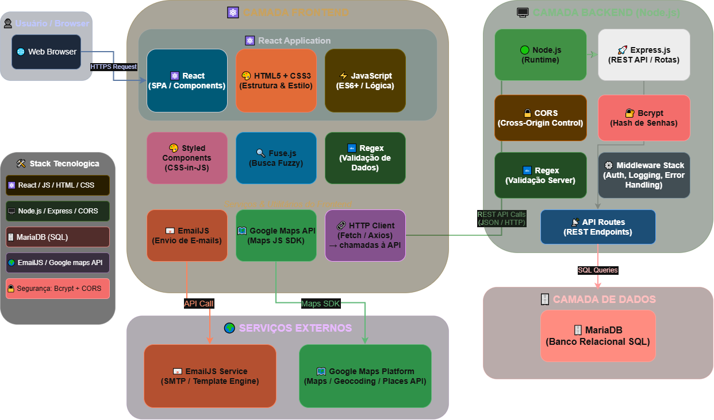

# Portal de Atividades do Centro Cultura Comunitário

Aplicação web para visualização das atividades gratuitas do Centro Cultura Comunitário.


<br><br/>

> **Projeto Integrador III — Universidade Virtual do Estado de São Paulo (UNIVESP)**  
> **Tema Oficial:** *"Desenvolver um software com framework web ou aplicativo que utilize banco de dados, inclua script web (Javascript), nuvem, acessibilidade, controle de versão, integração contínua e testes. Incluir um dos seguintes requisitos: uso e fornecimento de API, análises de dados e IoT."*

<br/>

>Nota: Este projeto foi desenvolvido como estudo de caso e proposta de interface para divulgação de atividades culturais e educacionais gratuitas. Todos os dados, nomes e contatos presentes nesta versão são puramente fictícios para fins de portfólio.

## Visão Geral

Este projeto foi desenvolvido como Projeto Integrador III da UNIVESP (Grupo 22) e propõe como solução o desenvolvimento de um portal para o Centro Cultura Comunitário, um espaço digital criado para que a comunidade possa se informar e se inscrever nas diversas atividades gratuitas que oferecemos. O objetivo deste projeto é facilitar o acesso à informação, centralizando em um único lugar todas as atividades disponíveis, com filtros e buscas que tornam a navegação mais ágil e intuitiva.

A aplicação foi estruturada com frontend e backend separados, permitindo que a interface e a lógica do sistema evoluam de forma independente, facilitando a manutenção e a adição de novas funcionalidades.

subir o readme pro gitlab sem a parte de arquitetura.
subir pro github a versao com dados ficticios.

## Arquitetura Cliente-Servidor Monolítica



<p align="center">
    <em>Arquitetura desenvolvida utilizando Draw.io</em>
</p>

A aplicação web segue uma arquitetura **Cliente-Servidor Monolítica**, organizada em três camadas bem definidas: **Frontend**, **Backend** e **Banco de Dados**, com integração a serviços externos.

O **frontend** é uma SPA (*Single Page Application*) desenvolvida com **React**, utilizando **JavaScript (ES6+)**, **HTML5**, **CSS3** e **Styled Components** para estilização dinâmica. A busca inteligente é provida pelo **Fuse.js** (busca fuzzy), e validações de entrada são realizadas com **Regex**. A comunicação com serviços externos inclui o **Google Maps API** (para exibição e interação com mapas) e o **EmailJS** (para envio de e-mails diretamente pelo cliente).

O **backend** é construído sobre **Node.js** com o framework **Express.js**, expondo uma API REST para o frontend. O middleware **CORS** controla o acesso entre origens distintas, e o **Bcrypt** garante o armazenamento seguro de senhas via hashing. Validações adicionais no servidor também utilizam **Regex**.

Os dados são persistidos em um banco de dados relacional **MariaDB**, acessado pelo backend via queries SQL.

## 🚀 Tecnologias Utilizadas

### 🎨 Frontend

[![React.js]][React-url] [![Vite]][Vite-url] [![Styled Components]][StyledComponents-url]
[![Fuse.js]][Fuse-url] [![Regex]][Regex-url]
---

### ⚙️ Backend

[![Node.js]][NodeJS-url] [![Express.js]][Express-url] [![CORS]][CORS-url]

---

### 🗄️ Banco de Dados

[![MariaDB]][MariaDB-url]

---

### 🔌 APIs e Integrações

[![EmailJS]][EmailJS-url] [![Google Maps]][GoogleMaps-url]

---

## ⚙️ Funcionalidades

-  Busca inteligente de atividades com base em palavras-chave com FuseJS;
-  Filtro de atividades por diferentes critérios;
-  Integração com Google Maps API para visualização de mapa interativo;
-  Integração com EmailJS para envio de formulário de contato;
-  Validação de endereço de e-mail com Regex no frontend;
-  Interface dinâmica com renderização condicional de componentes;
- Operações CRUD de atividades por meio de API;
- Sistema de autenticação para administradores;
- Verificação de permissões e autenticação de usuários; 
- Proteção de rotas privadas e controle de acesso administrativo;
- Testes automatizados e integração contínua (CI/CD).


## 📚 Estrutura do Projeto

O projeto está organizado em duas partes principais:

### 🎨 Frontend

Responsável pela interface do usuário, desenvolvido com React.

Principais diretórios:
- `assets/` → Imagens e arquivos estáticos
- `components/` → Componentes genéricos
- `context/` → Gerenciamento de autenticação
- `features/` → Funcionalidades do sistema
- `pages/` → Páginas da aplicação
- `routes/` → Rotas para as páginas
- `services/` → Comunicação com a API interna
- `utils/` → Funções genéricas
---

### ⚙️ Backend

Responsável pela lógica de negócio e comunicação com o banco de dados.

Principais diretórios:
- `bin/` → Arquivos de inicialização do servidor  
    - `www` → Responsável por iniciar a aplicação  

- `config/` → Configurações da aplicação  
    - `database.js` → Configuração da conexão com o banco de dados  
    - `test-db.js` → Script para testar a conexão com o banco  

- `app/` → Contém a lógica principal da aplicação  
---

## 🔧 Como Executar

Para executar o projeto em sua máquina local, siga os passos abaixo.

### Pré-requisitos

- **IDE:** Recomendado o uso do VS Code;
- **Node.js:** Versão LTS recomendada (>= 18);
- **Banco de Dados:** MariaDB ou MySQL.

### 1. Clonar o repositório

```bash
git clone https://github.com/lohan-ribeiro/nome do repositorio
```

### 2. Configurar o Banco de Dados

#### Configurações de segurança do MariaDB
- Isso irá tornar a instalação do MariaDB mais segura ao adicionar uma senha à conta `root`, remover acesso a usuários anônimos, etc.
    Use o comando:
    ```bash
    sudo mariadb-secure-installation
    ```
    Será feita uma série de perguntas. Geralmente é seguro responder sim ("Y") para todas elas.
#### Criação do Banco de Dados e Usuário(s)
- Autentique-se com o usuário `root` no  MariaDB, utilizando a senha configurada no passo anterior:
    ```bash
    sudo mariadb -u root -p
    ```
- Crie o banco de dados:
    ```sql
    CREATE DATABASE ceu;
- Crie o novo usuário e conceda os privilégios necessários:
    ```sql
    CREATE USER 'projeto'@'localhost' IDENTIFIED BY 'senha';
    GRANT ALL PRIVILEGES ON ceu.* TO 'projeto'@'localhost';
    FLUSH PRIVILEGES;
    ```
- Saia do MariaDB
    ```sql
    EXIT;
    ```
- Rode o script do banco de dados:
    ```bash
    sudo mariadb -u projeto -p ceu < projeto_db.sql
    ```
- Autentique-se novamente com o usuário `projeto` e visualize as tabelas
    ```bash
    sudo mariadb -u projeto -p ceu
    ```
    ```sql
    SHOW TABLES;
    ```
- Para verificar os registros execute:
    ```sql
    SELECT * FROM nome_da_tabela;
    ```

### 3. Iniciar o Backend

Abra um terminal e navegue até a pasta do `backend`:

```bash
cd backend
npm install
npm start
```

O servidor `backend` estará em execução em `http://localhost:3000`.

### 3. Iniciar o Frontend

Abra um segundo terminal e navegue até a pasta do `frontend`:

```bash
cd frontend
npm install
npm start
```

O site estará acessível em `http://localhost:5173`.

> Nota: Caso a porta configurada já esteja sendo utilizada por outra aplicação local, verifique no terminal a porta e o endereço (URL) disponibilizados para acessar a aplicação.
<br><br/>

## 🔐 Variáveis de Ambiente

Este projeto utiliza APIs externas e requer chaves de acesso (API Keys).

Crie um arquivo `.env` na raiz do projeto com as seguintes variáveis:

```env
VITE_EMAILJS_SERVICE_ID=ID_SERVICE_AQUI
VITE_EMAILJS_TEMPLATE_ID=ID_TEMPLATE_AQUI
VITE_EMAILJS_PUBLIC_KEY=CHAVE_API_AQUI

VITE_GOOGLE_MAPS_API_KEY=CHAVE_API_AQUI
```
---

## 👥 Integrantes do Grupo (UNIVESP — Grupo 22)

<table align="center">
  <tr>
    <td align="center">
      <a href="https://github.com/lohan-ribeiro">
        
        <br>
        <sub><b>Lohan Ribeiro Cerqueira</b></sub>
      </a>
    </td>
    <td align="center">
      <a href="https://github.com/rafanatdaniel-stack">
        
        <br>
        <sub><b>Rafael Dias de Santi</b></sub>
      </a>
    </td>
    <td align="center">
      <a href="https://github.com/FelipeSilva-Oliveira">
        
        <br>
        <sub><b>Felipe da Silva Faria de Oliveira</b></sub>
      </a>
    </td>
    <td align="center">
      <a href="https://github.com/RodrigoBitener">
        
        <br>
        <sub><b>Rodrigo Souza Machado Bitener</b></sub>
      </a>
    </td>
  </tr>

  <tr>
    <td align="center">
      <a href="">
        
        <br>
        <sub><b>Lucas Sousa Fraga</b></sub>
      </a>
    </td>
    <td align="center">
      <a href="">
        
        <br>
        <sub><b>David Barbosa Ferreira</b></sub>
      </a>
    </td>
    <td align="center">
      <a href="https://github.com/Wellington-Souza1990">
        
        <br>
        <sub><b>Wellington dos Santos de Souza</b></sub>
      </a>
    </td>
    <td align="center">
      <a href="https://github.com/waarruda">
        
        <br>
        <sub><b>Wilson Ademar de Arruda</b></sub>
      </a>
    </td>
  </tr>
</table>


## 📝 Licença

Esse projeto está sob licença apache. Veja o arquivo [LICENÇA](https://gitlab.com/grupo-pi-ii/projeto-integrador-ii/-/blob/main/LICENSE?ref_type=heads) para mais detalhes.


## 📚 Saiba Mais

Quer entender melhor como o projeto foi desenvolvido? Confira a documentação abaixo:

- [Relatório do projeto](docs/Relatorio%20final%20-%20PI3%20%20-%20formatado%20-%20V4.pdf) 
- [Repositório do Backend](https://gitlab.com/grupo-pi-ii/projeto-integrador-ii/-/tree/main/backend?ref_type=heads)
- [Repositório do Frontend](https://gitlab.com/grupo-pi-ii/projeto-integrador-ii/-/tree/main/frontend?ref_type=heads)
- [Documentação da API React Google Maps](https://visgl.github.io/react-google-maps/docs)
- [Documentação da API EmailJS](https://www.emailjs.com/docs/tutorial/overview/)


[React.js]: https://img.shields.io/badge/React-20232A?style=for-the-badge&logo=react&logoColor=61DAFB
[React-url]: https://react.dev/

[Vite]: https://img.shields.io/badge/Vite-563D7C?style=for-the-badge&logo=vite&logoColor=FFD62E
[Vite-url]: https://vitejs.dev/

[Node.js]: https://img.shields.io/badge/Node.js-43853D?style=for-the-badge&logo=node.js&logoColor=white
[NodeJS-url]: https://nodejs.org/

[Express.js]: https://img.shields.io/badge/Express.js-404D59?style=for-the-badge
[Express-url]: https://expressjs.com/

[CORS]: https://img.shields.io/badge/CORS-00599C?style=for-the-badge
[CORS-url]: https://developer.mozilla.org/pt-BR/docs/Web/HTTP/CORS

[MariaDB]: https://img.shields.io/badge/MariaDB-003545?style=for-the-badge&logo=mariadb&logoColor=white
[MariaDB-url]: https://mariadb.org/

[Styled Components]: https://img.shields.io/badge/Styled--Components-DB7093?style=for-the-badge&logo=styled-components&logoColor=white
[StyledComponents-url]: https://styled-components.com/

[Fuse.js]: https://img.shields.io/badge/Fuse.js-000000?style=for-the-badge
[Fuse-url]: https://fusejs.io/

[EmailJS]: https://img.shields.io/badge/EmailJS-FFB000?style=for-the-badge
[EmailJS-url]: https://www.emailjs.com/

[Google Maps]: https://img.shields.io/badge/Google%20Maps%20API-4285F4?style=for-the-badge&logo=googlemaps&logoColor=white
[GoogleMaps-url]: https://developers.google.com/maps

[Regex]: https://img.shields.io/badge/Regex-FF6F00?style=for-the-badge
[Regex-url]: https://developer.mozilla.org/pt-BR/docs/Web/JavaScript/Guide/Regular_Expressions

